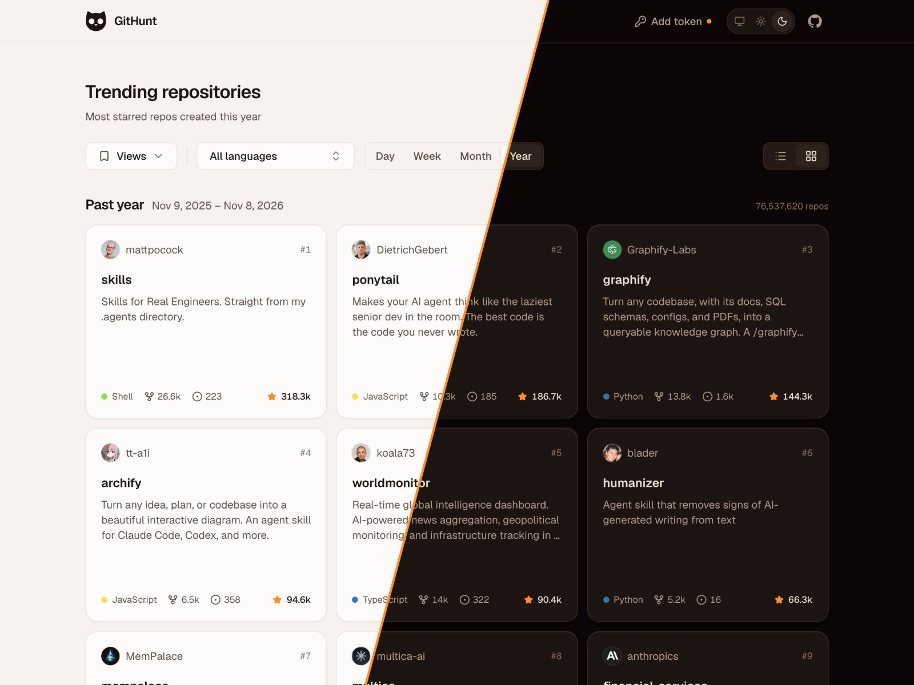

<picture>
  <source media="(prefers-color-scheme: dark)" srcset="./.github/logo-white.png" />
  
</picture>

# GitHunt

See the most starred new repos on GitHub from today, this week, this month or this year.

## Why

GitHub Trending shows what's popular right now, old repos included. GitHunt only shows repos that were created recently, sorted by stars. It's an easy way to find new projects early.

## Features

- Pick a day, week, month or year, and keep scrolling to go further back
- Filter by one or more languages, or hide repos with no language
- List or grid view, light or dark mode
- Save your filters and share them with a link
- Works right in your browser, no sign up needed

GitHub lets you search 10 times a minute without a token. [Add a token](https://github.com/settings/personal-access-tokens/new) from the top bar to get 30. It stays in your browser.

## License

MIT. See [license.md](./license.md).
