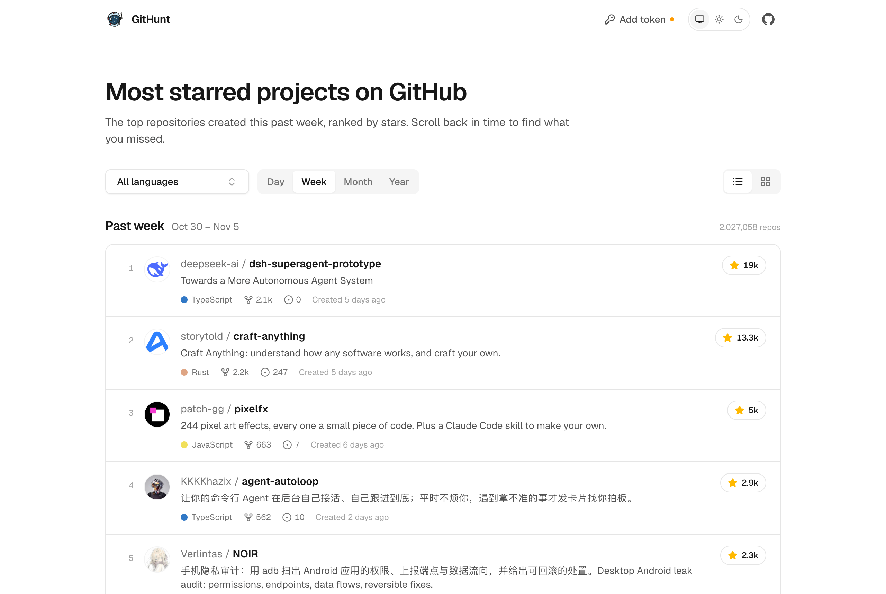
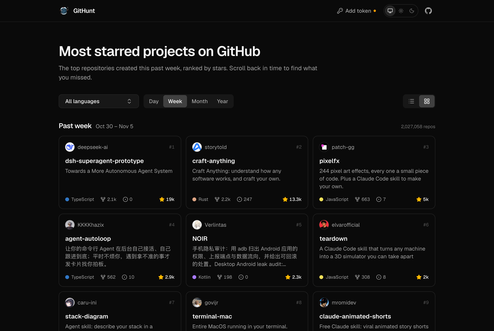
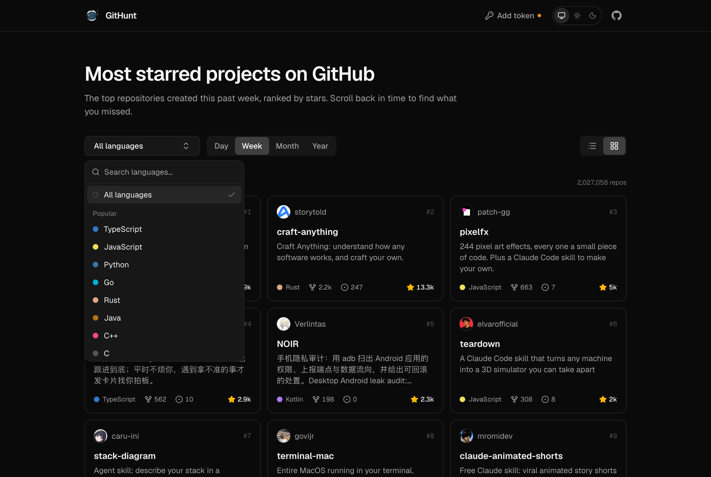

<h1 align="center">
  <br>GitHunt
</h1>

<p align="center">
  <b>Hunt the most starred projects on GitHub</b><br>
  <sub>Browse the top repositories created each day, week, month or year</sub>
</p>

<p align="center">
  
  <b>List view</b> – keep loading to go back in time
</p>

<p align="center">
  
  <b>Grid view</b> with dark mode
</p>

<p align="center">
  
  <b>Filter by language</b> – your selection is remembered
</p>

## Development

Built with React 19, TypeScript, Vite, Tailwind CSS v4 and TanStack Query.

```bash
pnpm install
pnpm dev      # start the dev server
pnpm build    # type-check and build to dist/
```

The build uses relative asset paths, so `dist/` can be served from any path (e.g. GitHub Pages).

## GitHub token

GitHub allows 10 anonymous search requests per minute. Add a [fine-grained personal access token](https://github.com/settings/personal-access-tokens/new) from the token button in the header to raise that to 30. The token is stored only in your browser.

## License

MIT © [Kamran Ahmed](https://kamranahmed.info)
